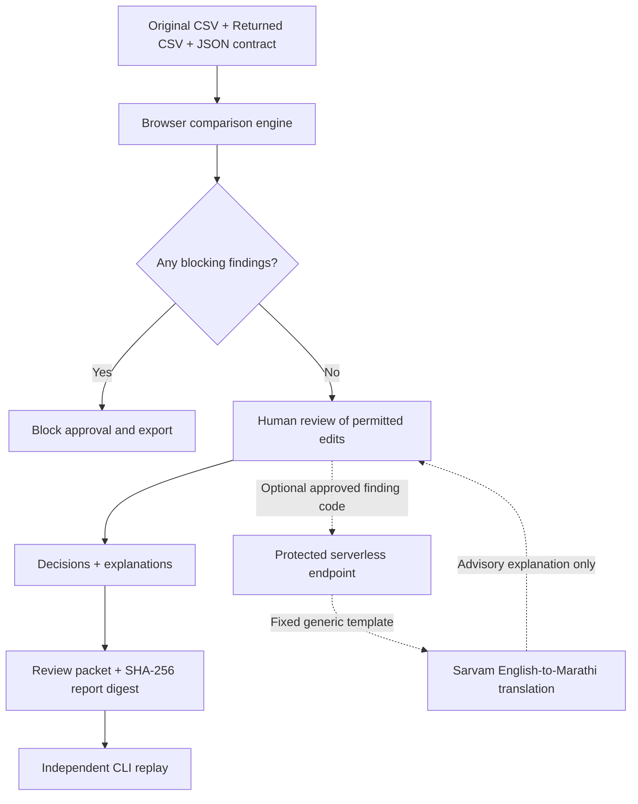

# HandoffGuard

**Contract-driven CSV handoff verification with human-in-the-loop review and optional Marathi assistance.**

[](https://github.com/Vinayak150/Handouff/actions/workflows/ci.yml)


HandoffGuard compares an original CSV with a returned CSV against an explicit editing contract. It flags prohibited changes, routes permitted edits through a documented review step, and produces a review packet that can be checked independently from the command line.

> [!IMPORTANT]
> **Provenance and readiness:** This repository contains an **independently reconstructed recovery reference**, not a verified copy of the original WUNDERDEVS HandoffGuard cohort implementation. The original baseline has not been reconciled. A public deployment and a real Sarvam provider call have **not been verified**. Use the supplied synthetic fixtures for demonstrations; do not treat this project as a production-approved compliance system.

**Jump to:** [Features](#features) · [Quick start](#quick-start) · [Example workflow](#example-workflow) · [CLI verification](#independent-cli-verification) · [Architecture](#architecture) · [Deployment](#deployment) · [Security](#security-and-data-handling)

## Why HandoffGuard?

Spreadsheet and CSV handoffs are easy to get wrong: a collaborator may change a protected field, remove a record, alter a key, or make a legitimate edit without recording why. HandoffGuard separates these cases using deterministic rules rather than letting an AI model decide whether a change is acceptable.

| Input | Purpose |
| --- | --- |
| **Original CSV** | Baseline records before the handoff |
| **Returned CSV** | Records received after the handoff |
| **Editing contract (JSON)** | Record key, required columns, and fields that may be edited |

The output is a set of **blockers** (changes that prevent approval) and **review findings** (permitted changes requiring a human decision).

## Features

- **Contract-based validation:** Detects missing or unexpected columns, blank or duplicate keys, row membership changes, and modifications to protected fields.
- **Deterministic change classification:** A prohibited edit is a blocker; a change to an explicitly editable field requires review.
- **Human review gate:** Eligible findings must be accepted or rejected with a 10–500 character explanation before export.
- **Fail-closed workflow:** Blockers disable approval/export, and changes to the input invalidate the previous review state.
- **Portable review evidence:** Exports a JSON packet containing review decisions and a SHA-256 report digest.
- **Independent verification:** `cli.cjs` re-analyzes the original inputs and checks a packet without importing the browser engine.
- **Optional Marathi guidance:** An explicit user action can request a Sarvam translation of an approved generic finding template. Translation is advisory and cannot change the verification outcome.
- **Test and release tooling:** Node-based tests, synthetic scenarios, static build checks, CI, and an opt-in hosted smoke test.

## Quick start

**Requirements:** Node.js **22 or newer**; Python 3 is optional for serving the static build. The core verification/build scripts use Node built-ins and do not require installing npm dependencies.

```bash
git clone https://github.com/Vinayak150/Handouff.git
cd Handouff

# Run tests, synthetic scenarios, build, and release asset audit.
npm run verify

# Serve the generated static application.
python3 -m http.server 8878 --directory dist --bind 127.0.0.1
```

Open **http://127.0.0.1:8878/** in your browser.

> [!NOTE]
> The Python server hosts static assets only. It does **not** execute the serverless Sarvam endpoint. CSV analysis, review, and export work without provider credentials; Marathi assistance requires a separately configured Function.

## Example workflow

1. Click **Load blocked example**, then **Analyze locally**. A forbidden amount edit produces a blocker, so a review packet cannot be exported.
2. Click **Load reviewable example**, then **Analyze locally**. The permitted status edit appears as a review finding.
3. Select the finding, enter a meaningful reason (10–500 characters), and choose **Accept** or **Reject**.
4. Click **Export review packet** to download `review-packet.json`.
5. Independently verify that exported packet using the original CSV, returned CSV, and contract as shown below.

Both examples are included in `fixtures/`. The included `review-packet-synthetic.json` is fixture data, **not** evidence of a human-signed approval.

### Editing contract

The sample contract in [`fixtures/contract.json`](fixtures/contract.json) is:

```json
{
  "keyColumn": "record_id",
  "requiredColumns": ["record_id", "customer", "status", "amount"],
  "editableColumns": ["status"]
}
```

Here, `record_id` identifies each record, all four columns must exist, and only `status` can change without producing a blocker. Even a permitted status change still requires a review decision.

## Independent CLI verification

The command-line tool uses a separate implementation of the comparison logic, providing a second path for analyzing the same files and replaying a review packet.

**Analyze a blocked handoff:**

```bash
node cli.cjs analyze \
  --original fixtures/original.csv \
  --returned fixtures/returned-blocked.csv \
  --contract fixtures/contract.json
```

Expected exit code: **2** (blocker present).

**Analyze a reviewable handoff:**

```bash
node cli.cjs analyze \
  --original fixtures/original.csv \
  --returned fixtures/returned-reviewable.csv \
  --contract fixtures/contract.json
```

Expected exit code: **0** (no blocker; review finding present).

**Verify the supplied synthetic packet:**

```bash
node cli.cjs verify \
  --original fixtures/original.csv \
  --returned fixtures/returned-reviewable.csv \
  --contract fixtures/contract.json \
  --packet fixtures/review-packet-synthetic.json
```

Expected exit code: **0**, with `"verified": true`. For a packet exported from the browser, replace `--packet` with the downloaded file path. Verification fails if the packet no longer matches the analyzed data or does not contain valid decisions for all required review findings.

The digest is a **tamper-evident consistency check**, not a digital signature, authenticated reviewer identity, or proof that a person approved the data.

## Architecture



| Component | Responsibility |
| --- | --- |
| [`public/engine.js`](public/engine.js) | Browser CSV parsing, contract validation, deterministic findings, and report digest |
| [`public/app.js`](public/app.js) and [`public/session.js`](public/session.js) | User interaction, review state, and packet export |
| [`public/sarvam-assistance.js`](public/sarvam-assistance.js) | Optional client-side explanation UI |
| [`functions/api/sarvam/translate.js`](functions/api/sarvam/translate.js) | Cloudflare Pages Function for protected translation requests |
| [`functions/_shared/templates.js`](functions/_shared/templates.js) | Allowlisted, versioned English finding templates |
| [`api/sarvam/translate.js`](api/sarvam/translate.js) | Optional Vercel serverless adapter |
| [`cli.cjs`](cli.cjs) | Independent analysis and packet replay |
| [`tests/`](tests) and [`scripts/`](scripts) | Regression tests, scenario checks, build, and release tooling |
| [`fixtures/`](fixtures) | Synthetic inputs, editing contract, and demonstration packet |

**Stack:** Vanilla JavaScript, HTML, CSS, Node.js 22+, Cloudflare Pages Functions, optional Vercel adapter, and Sarvam translation API.

## Development and testing

| Command | What it checks |
| --- | --- |
| `npm test` | Automated engine, security configuration, provider-mock, and adapter tests |
| `npm run scenarios` | Blocked and reviewable synthetic handoff flows |
| `npm run build` | Copies the allowlisted static assets into `dist/` |
| `npm run audit:release` | Release/public asset audit |
| `npm run verify` | Runs all four checks above in sequence |
| `npm run live:check` | Opt-in check against a separately configured HTTPS deployment |

GitHub Actions configuration is in [`.github/workflows/ci.yml`](.github/workflows/ci.yml). Tests use mocked provider responses; **passing tests do not establish live provider or hosted deployment readiness**.

## Deployment

**Cloudflare Pages** is the documented reference deployment path:

1. Run `npm run verify` locally.
2. Connect the repository to Cloudflare Pages with the framework set to **None**, build command `npm run build`, and output directory `dist`.
3. Keep `functions/` at the repository root so Cloudflare can deploy the API route.
4. Add `SARVAM_API_KEY` and `HANDOFFGUARD_DEMO_TOKEN` as private encrypted server-side secrets **only** if running a supervised translation demo.
5. Verify the deployed static application, response headers, blocked/reviewable flow, wrong-token behavior, and any explicitly authorized live provider call.

For a **local Pages Function** test (instead of the static-only Python server):

```bash
npm run build
npx wrangler pages dev dist
```

Wrangler may require setup and private local `.dev.vars` values. Do not commit secrets. The repository also contains an optional Vercel adapter, but its presence does not imply that either hosting platform has been deployed or validated.

See [Deployment runbook](docs/DEPLOYMENT.md), [Configuration reference](CONFIGURATION.md), and [Release proof gates](docs/RELEASE_PROOF_GATES.md).

## Security and data handling

The browser performs CSV comparison locally. Under the implemented translation flow, only an allowlisted **finding code**, the target language, and a transient demo access token reach the serverless API. The provider is sent a fixed generic English template, **not** CSV rows, filenames, review notes, or arbitrary user text. Translated text never enters review decisions or exported packets.

Important boundaries:

- **No accounts or reviewer identity verification.** The demo token is a shared access gate, not user authentication.
- **No cryptographic signatures or persistent audit log.** The report hash checks consistency, not nonrepudiation.
- **No global request quota.** The serverless in-memory limiter is a soft per-isolate guard, not a provider spend cap.
- **No verified production deployment or real Sarvam call.** Hosted privacy and provider behavior still require operator validation.
- **CSV-focused scope.** The current browser UI does not support XLSX, and it is not a general-purpose reconciliation engine.

Do not process sensitive customer data or publicly enable paid provider requests without an approved security, privacy, and cost-control review.

More detail: [Security model](docs/SECURITY_MODEL.md) · [Release security checklist](docs/RELEASE_SECURITY_CHECKLIST.md).

## Project status and provenance

This codebase is a **reconstructed technical reference**. The original WUNDERDEVS cohort baseline is unavailable for a source-level comparison, so equivalence to the historical application or its earlier test counts **must not be assumed**. Source reconciliation, live Sarvam verification, deployment evidence, human Marathi review, and release approval remain separate gates.

For evidence and known gaps, refer to [Source reconciliation](docs/SOURCE_RECONCILIATION_STATUS.md), [Implementation handoff](IMPLEMENTATION_HANDOFF.md), and [Submission status](docs/SUBMISSION_STATUS.md). Some historical handoff documents describe earlier snapshots and should not be read as current runtime proof.

## Contributing and licensing

Bug reports and focused pull requests are welcome for review. Keep changes small, include tests for new behavior, and run `npm run verify` before opening a PR.

**License:** No root `LICENSE` has been approved or added. Public visibility does not grant reuse or redistribution rights. See [OSS license review](docs/OSS_LICENSE_REVIEW.md) for the outstanding ownership and licensing decisions.

---

Maintained in [`Vinayak150/Handouff`](https://github.com/Vinayak150/Handouff).
